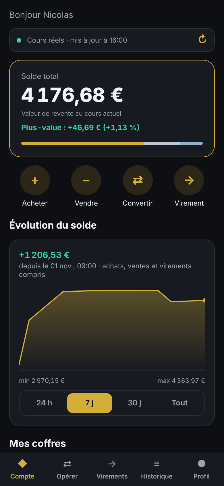
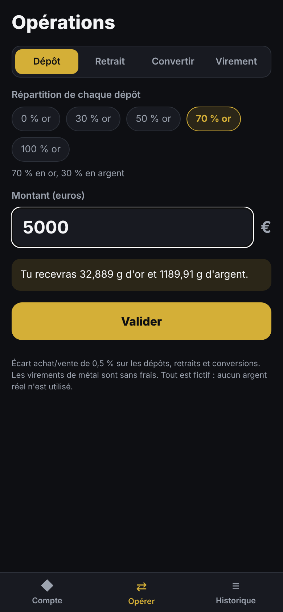
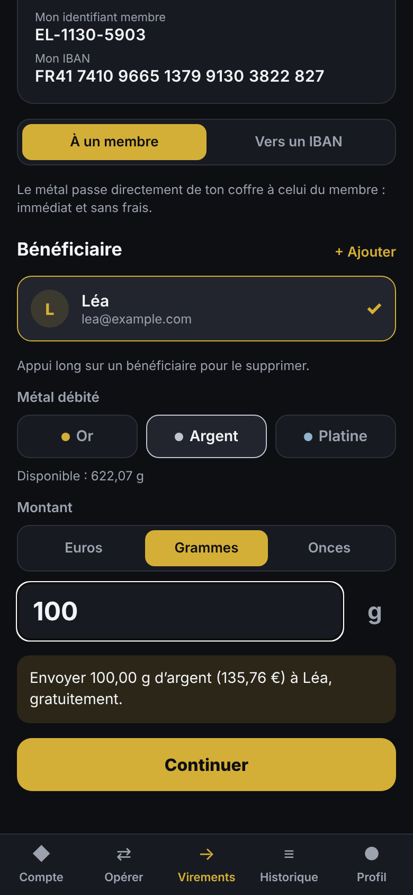
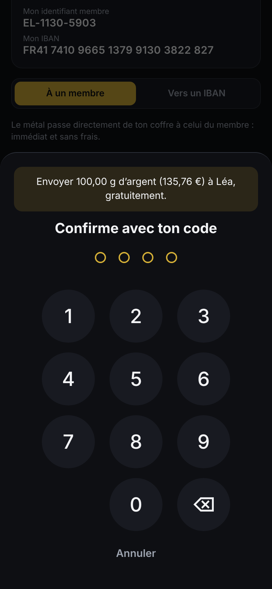
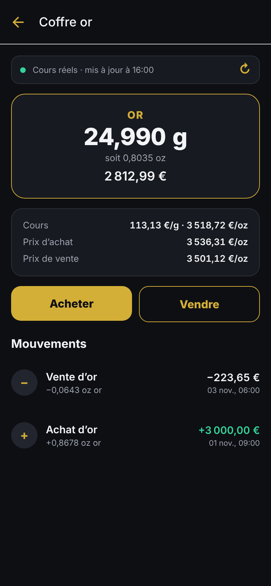
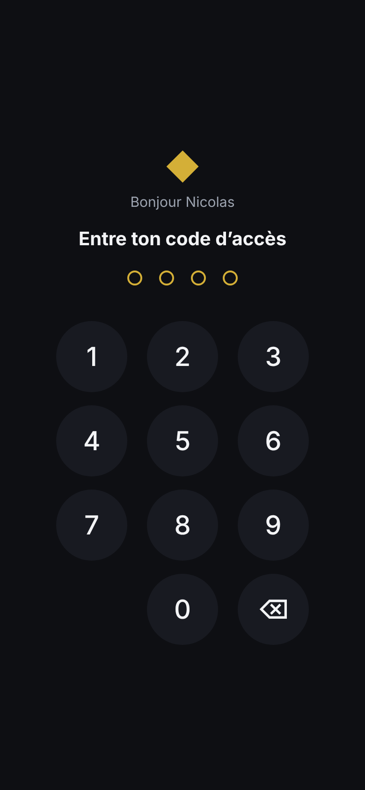

# Orvia — compte adossé à l'or, à l'argent et au platine (démo)


Application mobile (Expo / React Native) qui simule un compte dont le solde est détenu en
métaux précieux. **Les cours sont réels**, mais les achats, ventes et virements sont fictifs :
aucun argent ni métal réel n'est échangé.

<p>
  
  
  
</p>
<p>
  
  
  
</p>

## Utiliser l'appli dans le navigateur

Version web, sans installation : **https://nicox32.github.io/elrond/**
Dans Chrome, menu ⋮ → **Ajouter à l'écran d'accueil** pour l'ouvrir comme une appli.
(Publiée par `.github/workflows/web.yml` ; GitHub Pages doit être réglé sur la source « GitHub Actions ».)

## Installer sur Android

Téléchargez l'APK depuis votre téléphone :
**https://github.com/nicox32/elrond/releases/latest/download/orvia.apk**

Il est reconstruit automatiquement à chaque modification (voir `.github/workflows/android-apk.yml`).

## Fonctionnalités

- **Cours réels** de l'or, de l'argent et du platine (au comptant, en dollars par once, convertis en
  euros par gramme). Actualisés à l'ouverture de l'appli, au retour dans l'appli, à sa fermeture et
  d'un appui sur la barre des cours. Hors ligne, l'appli garde les derniers cours connus et le signale.
- **Cours en direct** des trois métaux sur l'écran du compte, actualisés toutes les 30 s, avec leur
  variation et leur courbe sur les dernières 24 h (voir `docs/cours-en-direct.png`).
- **Trois coffres** : or, argent, platine, avec leur valeur et le détail des mouvements.
- **Achat et vente en euros, en grammes ou en onces troy** (1 oz = 31,1035 g). Affichage au choix
  en grammes ou en onces.
- **Conversion** d'un métal à l'autre.
- **Virements**, sur le modèle des comptes adossés aux métaux :
  - **à un membre** (identifiant, e-mail ou téléphone) : le métal passe de coffre à coffre, immédiat et sans frais ;
  - **vers un IBAN** : le métal est vendu puis les euros partent par virement SEPA (IBAN vérifié).
- **Sécurité** : code à 4 chiffres à chaque ouverture et pour valider chaque virement, déverrouillage
  par empreinte en option, blocage de 30 s après 5 codes faux. Seule une empreinte salée du code est
  conservée, dans le trousseau sécurisé du téléphone.
- **Graphique d'évolution du solde** (24 h, 7 j, 30 j, tout) et **plus-value latente**.
- **Le louis (LOU)**, monnaie interne d'Orvia : 1 LOU = 1 € de métal précieux au cours du moment ;
  le solde s'affiche aussi en louis.
- **Carte Orvia** (simulée) : carte de paiement virtuelle adossée aux métaux du compte ; chaque paiement
  ou retrait vend le métal choisi au cours du moment, sans frais ; plafonds de 3 000 € / 30 jours
  (paiements) et 500 € / 7 jours (retraits) ; gel en un geste (`docs/carte.png`).
- **Parrainage** : un code par compte à partager ; le filleul reçoit 10 LOU en or à son premier achat
  d'au moins 50 € (`docs/parrainage.png`). Sans serveur, le parrain n'est pas encore crédité.
- **Reprise de l'historique 2021** (Profil) : compte ouvert le 5 janvier 2021, 12 achats le 5 de chaque mois
  (3 845 €, 3/4 argent et 1/4 or par défaut, modifiables), aux cours approximatifs de 2021, sans frais et sans
  oxydation rétroactive (`docs/historique-2021.png`).
- **Alertes de prix** (🔔 sur l'écran du compte) : seuil de prix, variation sur 24 h ou 7 jours, écart à la
  moyenne 30 jours, pour chaque métal ; notification une seule fois par franchissement (6 h minimum entre deux),
  historique avec raccourcis Acheter / Vendre (`docs/alertes.png`). Ce sont les conditions de l'utilisateur, pas
  des conseils d'investissement. Version web : vérifiées quand l'appli est ouverte (pas encore de serveur).
- **Alertes 24 h/24** : `.github/workflows/alertes.yml` vérifie les cours toutes les 15 minutes avec la même
  logique que l'appli (`server/alertServer.ts`) et envoie les alertes par [ntfy](https://ntfy.sh). Réglages :
  secret `NTFY_TOPIC` (canal secret généré dans l'appli), alertes dans `server/alerts.json` (export depuis l'écran
  Alertes). L'état (relevés, alertes déjà envoyées) est gardé dans le cache GitHub Actions.
- **Répartition** (« Répartition » sur l'écran du compte, l'écran Opérer ou le Profil) : objectif en % par métal
  (modèles 50/25/25, 60/20/20…), comparaison avec la répartition actuelle, et **achat réparti en euros** en un geste,
  « selon mes % » ou « vers mon objectif » (priorité aux métaux en retard, sans rien vendre) (`docs/repartition.png`).
- **Grille tarifaire** (voir `src/logic/fees.ts` et l'écran Tarifs, `docs/tarifs.png`) :
  achat 2,8 % (or), 6,8 % (argent, platine) ; revente par virement 0,8 % (+ 30 € hors de France) ;
  écart de 2,8 % en virement immédiat, aucun en différé (J+2) ; conversion 0,8 % + frais d'achat ;
  envois et réceptions entre membres gratuits.
- **Comptes enfants gratuits**, aux règles inspirées du droit français (à faire valider par un juriste) :
  - l'argent versé appartient à l'enfant (c'est un don) : le parent ne peut pas le reprendre pour lui-même ;
  - retrait seulement pour une **dépense faite pour l'enfant** (motif obligatoire), **validé par le second parent**
    avec son propre code quand l'autorité parentale est partagée (Cass. com., 12 juin 2025), ou par le parent seul
    s'il l'exerce seul ;
  - un versement fait par erreur peut être annulé seul dans les 24 h ;
  - **aucun frais avant 18 ans** ; à la majorité, le parent ne gère plus le compte et le **transfère à l'enfant**
    (code de rattachement) ; logique dans `src/logic/childRules.ts` (`docs/compte-enfant.png`).
- **Frais d'oxydation** : un compte (principal, ou enfant devenu majeur) laissé 6 mois calendaires sans opération éligible
  d'au moins 1 € (paiement ou retrait par carte, échange de louis, achat, parrainage) est facturé 0,02 % du solde par jour sur ces 6 mois (environ 3,6 %), en métal ; chaque nouvelle
  période de 6 mois d'inactivité est facturée de même. L'appli prévient un mois avant (`docs/oxydation.png`).

Sources des cours : [gold-api.com](https://gold-api.com) (métaux) et
[Frankfurter](https://frankfurter.dev) / [open.er-api.com](https://open.er-api.com) (taux USD → EUR).

## Développement

```bash
npm install
npx expo start      # puis scanne le QR code avec Expo Go
npm test            # tests de la logique du compte
npm run typecheck   # vérification TypeScript
npm run lint        # lint
```

## Organisation du code

- `src/app/` : écrans (Expo Router) — onglets Compte, Opérer, Virements, Historique, Profil, et `coffre/[metal]`
- `src/logic/` : logique pure (compte, cours, formatage), testée dans `scripts/ledger.test.ts`
- `src/state/BankProvider.tsx` : état du compte, actualisation des cours, verrouillage
- `src/security.ts` : code d'accès et empreinte
- `scripts/brand/make_logo.py` : génère le logo (louis d'or) et toutes les icônes
- `src/components/`, `src/features/` : composants, ouverture de compte et déverrouillage
