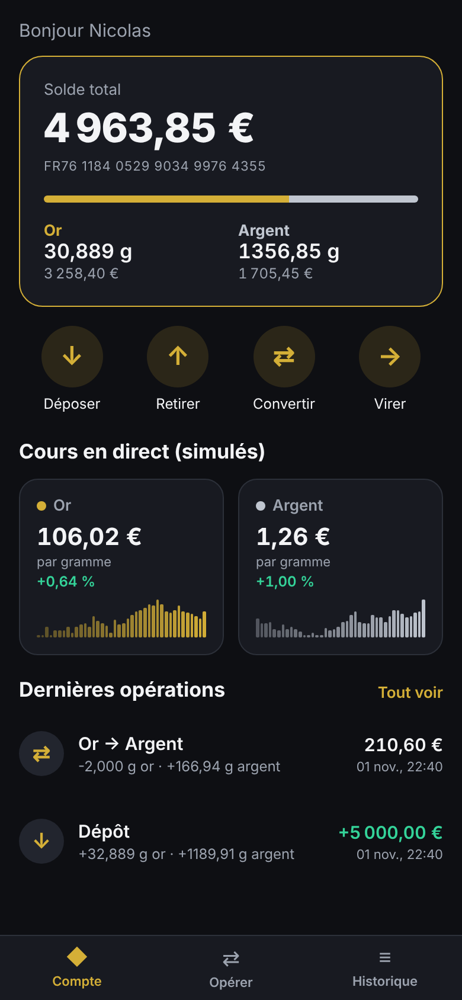

# Elrond — compte adossé à l'or et à l'argent (démo)

Application mobile (Expo / React Native) qui simule un compte bancaire dont chaque euro
est converti en grammes d'or et d'argent. **Tout est fictif** : aucun argent réel, cours simulés.

<p>
  
  
</p>

## Fonctionnalités

- **Dépôt** : les euros sont convertis en or et en argent selon une répartition choisie (0 à 100 % d'or).
- **Retrait** : vend de l'or, de l'argent ou les deux au prorata.
- **Conversion** : or → argent ou argent → or.
- **Virement** : envoie des grammes de métal à un bénéficiaire, sans frais.
- **Cours en direct simulés** (mis à jour toutes les 3 s) avec mini-graphiques.
- Écart achat/vente de 0,5 %, historique des opérations, données sauvegardées sur le téléphone.

## Lancer l'appli

```bash
npm install
npx expo start
```

Scanne le QR code avec l'appli **Expo Go** (Android / iPhone), ou appuie sur `w` pour l'ouvrir dans le navigateur.

## Vérifications

```bash
npm test          # tests de la logique du compte
npm run typecheck # vérification TypeScript
```

## Organisation du code

- `src/logic/` : logique pure (comptes, cours, formatage), testée dans `scripts/ledger.test.ts`
- `src/screens/` : écrans Compte, Opérations, Historique
- `src/components/` : composants réutilisables
- `App.tsx` : écran d'accueil, navigation par onglets, simulation des cours
